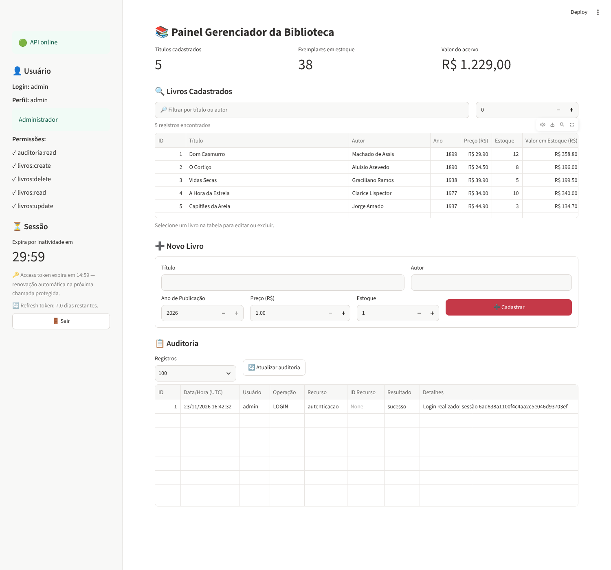
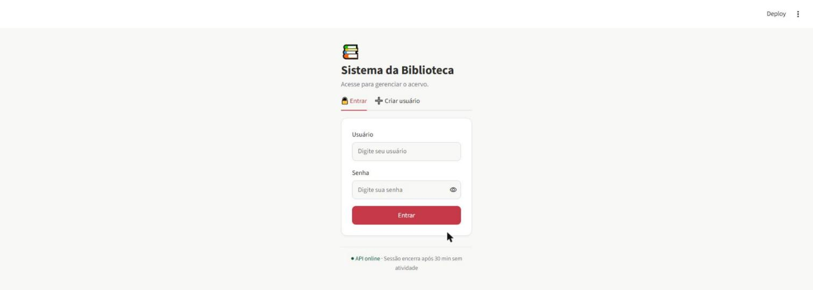

# Sistema Distribuído: Gerenciador de Biblioteca

Trabalho da disciplina baseado no **Estudo de Caso: Sistema Distribuído** (até a **versão 9**).

Seguimos a **estratégia 2** da atividade: **a linguagem e as bibliotecas são as mesmas do roteiro**
(Python, FastAPI e Streamlit), mas **o modelo conceitual/MER muda**. Em vez do CRUD de `vendas`,
o sistema gerencia o **acervo de livros de uma biblioteca/livraria**.

Toda a camada de segurança da versão 9 foi mantida:

- Autenticação OAuth2 (Password Flow) com JWT
- Perfis (`admin` / `usuario`) e autorização por *scopes*
- Access token (15 min) e refresh token (7 dias) com rotação
- Identificador de sessão (`sid`) e logout com revogação da sessão
- Encerramento por inatividade (30 min), controlado pelo backend
- Contador visual da sessão no frontend
- Auditoria de eventos (login, refresh, logout, CRUD e acessos negados)
- Respostas 401 (não autenticado) e 403 (sem permissão) tratadas separadamente



---

## Integrantes da equipe

| Nome |
|------|
| João Vitor Pereira Da Silva |
| Fabiano Pirolli |
| Lucas Zornitta |
| Matheus Stamguerlin |

---

## Modelo de dados (MER)

### Tabela de domínio `livro` (substitui a tabela `venda`)

| Campo            | Tipo          | Restrições / Observação                              |
|------------------|---------------|------------------------------------------------------|
| `id`             | INTEGER       | Chave primária                                       |
| `titulo`         | VARCHAR(200)  | Obrigatório, não pode ser só espaços; indexado       |
| `autor`          | VARCHAR(120)  | Obrigatório, não pode ser só espaços; indexado       |
| `ano_publicacao` | INTEGER       | Entre 1450 e o ano atual                             |
| `preco`          | NUMERIC(10,2) | Maior que zero (armazenado como `Decimal`)           |
| `estoque`        | INTEGER       | Maior ou igual a zero (exemplares disponíveis)       |

### Tabelas de infraestrutura (iguais às da versão 9)

| Tabela                  | Função                                                                |
|-------------------------|-----------------------------------------------------------------------|
| `usuario`               | Usuários, hash da senha (Argon2) e perfil (`role`)                    |
| `refreshtoken`          | Hash dos refresh tokens, sessão (`sessao_id`), expiração e atividade |
| `logauditoria`          | Registros de auditoria (usuário, operação, recurso, resultado...)     |
| `controleinicializacao` | Indica se os livros de demonstração já foram inseridos                |

```
usuario 1 ──── N refreshtoken        (usuario.id = refreshtoken.usuario_id)
logauditoria   (registra ações sobre livro, usuario, autenticacao e sessao)
livro          (entidade de domínio do CRUD)
```

### O que mudou em relação ao roteiro (vendas → livros)

| Roteiro (versão 9)                         | Este projeto                                          |
|--------------------------------------------|-------------------------------------------------------|
| `Venda(id, item, preco_unitario, quantidade)` | `Livro(id, titulo, autor, ano_publicacao, preco, estoque)` |
| Scopes `vendas:read/create/update/delete`  | Scopes `livros:read/create/update/delete`             |
| `GET /vendas/faturamento` (Σ preço × qtd)  | `GET /livros/valor-acervo` (Σ preço × estoque)        |
| `GET /vendas/qtd-vendas`                   | `GET /livros/quantidade` (títulos e exemplares)       |
| `GET /vendas/busca?nome=&min_qtd=`         | `GET /livros/busca?texto=&min_estoque=` (título **ou** autor) |
| Banco `vendas.db`                          | Banco `biblioteca.db`                                 |
| Recurso de auditoria `venda`               | Recurso de auditoria `livro`                          |

---

## Endpoints da API

| Método | Rota                    | Scope exigido    | Descrição                                   |
|--------|-------------------------|------------------|---------------------------------------------|
| GET    | `/`                     | (público)        | Health check                                |
| POST   | `/usuarios`             | (público)        | Cadastra usuário comum                      |
| POST   | `/token`                | (público)        | Login OAuth2 e emissão do par de tokens     |
| POST   | `/refresh`              | (refresh token)  | Renova e rotaciona os tokens                |
| POST   | `/logout`               | (refresh token)  | Encerra a sessão e revoga os tokens         |
| GET    | `/me`                   | autenticado      | Perfil, scopes e sessão do usuário          |
| GET    | `/auditoria`            | `auditoria:read` | Lista os registros de auditoria             |
| GET    | `/livros`               | `livros:read`    | Lista todos os livros                       |
| GET    | `/livros/quantidade`    | `livros:read`    | Total de títulos e de exemplares            |
| GET    | `/livros/valor-acervo`  | `livros:read`    | Valor total do estoque (preço × estoque)    |
| GET    | `/livros/busca`         | `livros:read`    | Filtro por título/autor e estoque mínimo    |
| GET    | `/livros/{id}`          | `livros:read`    | Consulta um livro                           |
| POST   | `/livros`               | `livros:create`  | Cadastra livro                              |
| PUT    | `/livros/{id}`          | `livros:update`  | Altera livro                                |
| DELETE | `/livros/{id}`          | `livros:delete`  | Exclui livro                                |

**Perfis:**

- `admin`: todos os scopes (`livros:*` e `auditoria:read`)
- `usuario`: `livros:read`, `livros:create` e `livros:update`. Não pode excluir livros nem ver a auditoria.

A documentação interativa (Swagger) fica em <http://127.0.0.1:8000/docs> com o backend rodando.

---

## Como instalar

Pré-requisitos: **Python 3.12 ou superior** (o roteiro usa 3.14) e **Git**.

### Opção A: PyCharm (como no roteiro)

1. Na tela inicial do PyCharm, clique em **Clone Repository** (ou, com um projeto aberto,
   **File → Project from Version Control...**).
2. Em **URL**, cole `https://github.com/DEVBORGES1/Sistema-Distribuido.git`, escolha a pasta
   (ex.: `C:\programas\ad-2026\Sistema-Distribuido`) e clique em **Clone**. Confirme **Trust Project**.
3. Configure o ambiente virtual:
   - **File → Settings → Project: Sistema-Distribuido → Python Interpreter**
   - **Add Interpreter → Add Local Interpreter... → Virtualenv Environment → New**
   - Local: pasta `.venv` dentro do projeto; Base interpreter: Python 3.12 ou superior (o roteiro usa 3.14)
   - Clique em **OK**. O canto inferior direito do PyCharm deve mostrar `.venv [3.x]`.

   > Se o PyCharm mostrar o aviso *"Install requirements from requirements.txt"*, pode clicar em
   > **Install** e pular o passo 4.
4. Abra o terminal embutido (`Alt + F12` ou **View → Tool Windows → Terminal**). O prompt deve
   começar com `(.venv)`. Instale as dependências:

   ```bash
   pip install -r requirements.txt
   ```

   > Se o prompt não mostrar `(.venv)`, feche e abra o terminal de novo, ou ative manualmente
   > com `.venv\Scripts\Activate.ps1`. Se o PowerShell bloquear o script, rode antes
   > `Set-ExecutionPolicy -Scope CurrentUser RemoteSigned`.

### Opção B: terminal

```bash
git clone https://github.com/DEVBORGES1/Sistema-Distribuido.git
cd Sistema-Distribuido
python -m venv .venv
```

Ative o ambiente virtual:

- Windows (PowerShell): `.venv\Scripts\Activate.ps1`
- Linux/macOS: `source .venv/bin/activate`

```bash
pip install -r requirements.txt
```

---

## Como rodar

São dois processos que precisam ficar rodando **ao mesmo tempo**, cada um em seu terminal:
primeiro o backend, depois o frontend.

### Rodando no PyCharm (passo a passo)

1. Abra o terminal embutido (`Alt + F12`). Essa é a aba **Local**.
2. Na aba **Local**, inicie o **backend**:

   ```bash
   uvicorn backend_fastapi:app --reload
   ```

   Espere aparecer `Application startup complete.` e `Uvicorn running on http://127.0.0.1:8000`.
   **Não feche esta aba**: a API precisa continuar rodando.
3. Clique no **`+`** ao lado da aba **Local** para abrir uma segunda aba, **Local (2)**. Ela também
   deve mostrar `(.venv)` no prompt.
4. Na aba **Local (2)**, inicie o **frontend**:

   ```bash
   streamlit run frontend_streamlit.py
   ```

   O navegador abre sozinho em <http://localhost:8501>. Se não abrir, clique no link
   `Local URL` que aparece no terminal.
5. Na barra lateral do painel deve aparecer **🟢 API online**. Faça login com `admin` / `admin123`
   (ver [Login](#login)).
6. Para encerrar, clique em cada aba do terminal e pressione `Ctrl + C`.

> **Dica:** com o `--reload`, o backend reinicia sozinho quando `backend_fastapi.py` é salvo.
> O Streamlit também detecta alterações e oferece **Rerun** no canto superior direito da página.

**Problemas comuns no PyCharm**

| Sintoma | Solução |
|---------|---------|
| `uvicorn` / `streamlit` não é reconhecido como comando | O terminal não está com o `.venv` ativo. Verifique o interpretador (passo 3 da instalação) e reabra o terminal. |
| Painel mostra **🔴 API indisponível** | O backend não está rodando na aba **Local**. Inicie-o antes do frontend. |
| `[Errno 10048]` / porta 8000 em uso | Já existe outro backend aberto (ex.: o do roteiro). Feche-o com `Ctrl + C`. |
| Erro de banco depois de alterar o código | Pare o backend, apague `biblioteca.db` e rode de novo. |

### Rodando em outro terminal (sem PyCharm)

Com o ambiente virtual ativo, use dois terminais:

**Terminal 1: backend (API FastAPI)**

```bash
uvicorn backend_fastapi:app --reload
```

A API sobe em <http://127.0.0.1:8000>. Na primeira execução o arquivo `biblioteca.db` é criado
com 5 livros de exemplo e o usuário administrador.

**Terminal 2: frontend (Streamlit)**

```bash
streamlit run frontend_streamlit.py
```

O painel abre em <http://localhost:8501>.

### Login

| Usuário | Senha      | Perfil        |
|---------|------------|---------------|
| `admin` | `admin123` | Administrador |

Também é possível criar um usuário comum pela tela de login (*Criar usuário*), para testar as
restrições de permissão (o botão **Excluir** e a seção **Auditoria** não aparecem para ele).

### Variáveis de ambiente opcionais

| Variável                 | Padrão                                  | Uso                              |
|--------------------------|-----------------------------------------|----------------------------------|
| `JWT_SECRET`             | chave local de desenvolvimento          | Chave HS256 (mínimo de 32 bytes) |
| `ADMIN_USERNAME`         | `admin`                                 | Login do administrador inicial   |
| `ADMIN_INITIAL_PASSWORD` | `admin123`                              | Senha do administrador inicial   |

> Para recomeçar do zero, pare o backend e apague o arquivo `biblioteca.db`.

---

## Estrutura do projeto

```
.
├── backend_fastapi.py      # API REST (FastAPI + SQLModel + SQLite + OAuth2/JWT)
├── frontend_streamlit.py   # Interface web (Streamlit)
├── requirements.txt        # Dependências
├── docs/                   # Capturas de tela
└── README.md
```


